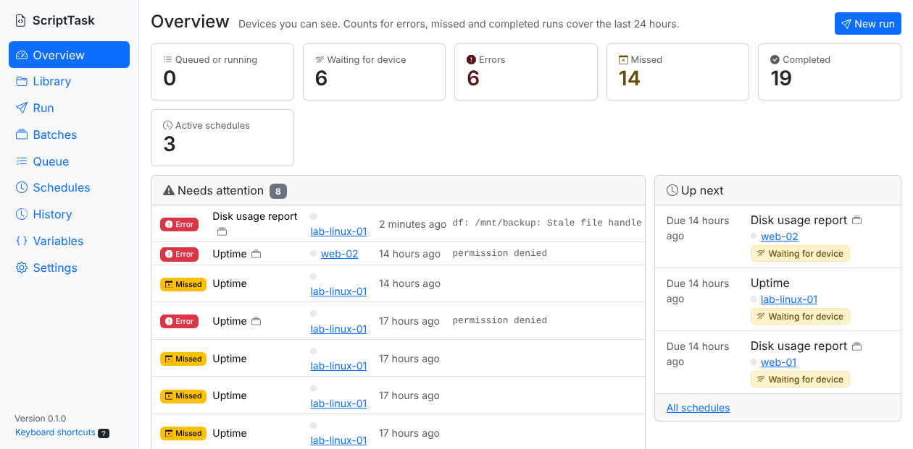
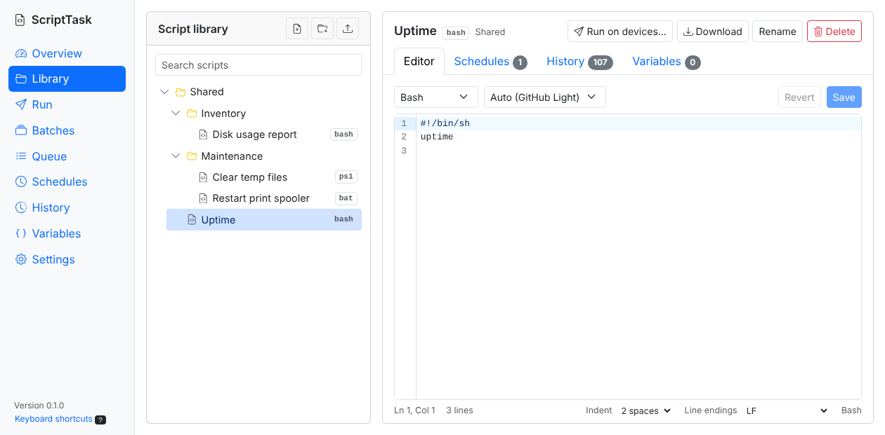
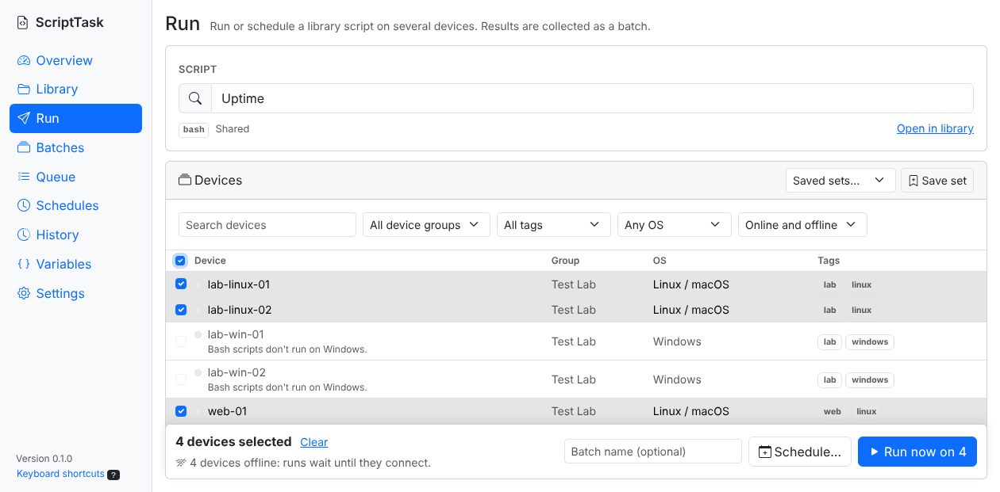
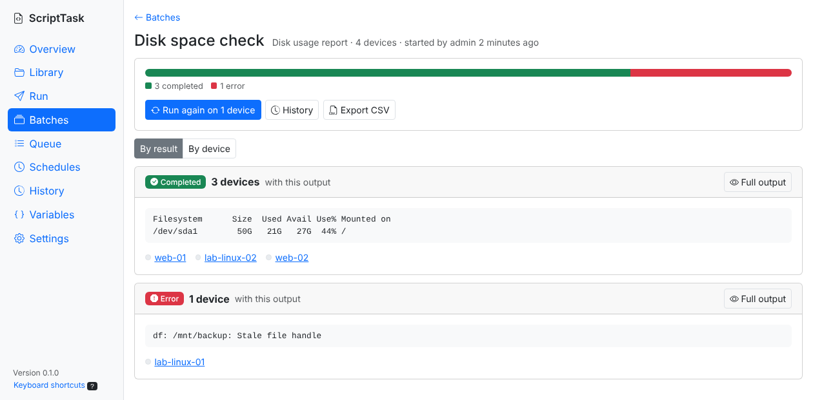
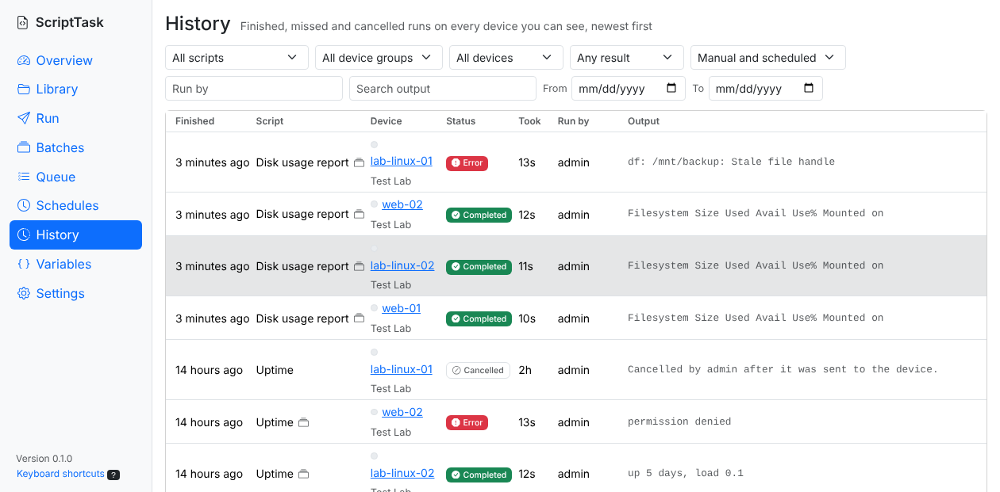
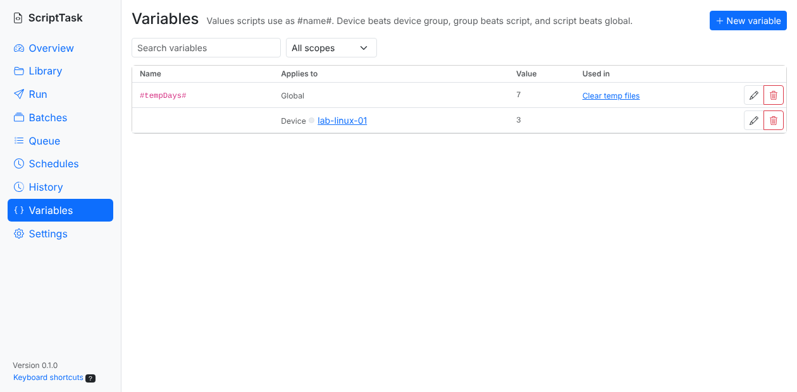
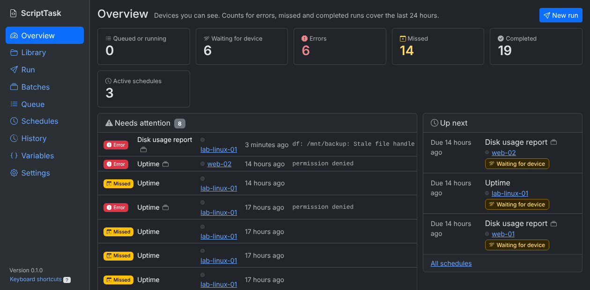
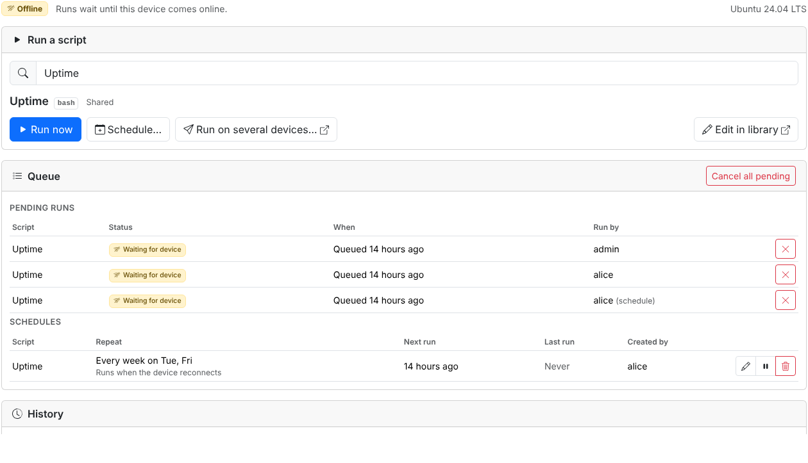

# MeshCentral-ScriptTask

A script runner plugin for [MeshCentral](https://github.com/Ylianst/MeshCentral). Keep PowerShell, Batch and Bash scripts in a central library, run them on one device or many, schedule them, and review their output.

Maintained by Desmond Duval. This is a fork of [ryanblenis/MeshCentral-ScriptTask](https://github.com/ryanblenis/MeshCentral-ScriptTask), the original plugin by Ryan Blenis, with a redesigned interface that fits MeshCentral's Modern UI, a server-wide management page, batches, and a new scheduling engine. See the [changelog](changelog.md) for everything that changed.



## Requirements

- MeshCentral 1.2.0 or later, using the **Modern UI**. The Classic UI shows a notice asking you to switch.
- Plugins enabled in MeshCentral's `config.json`:
  ```json
  "plugins": { "enabled": true }
  ```
  Restart MeshCentral after changing it.
- NeDB (MeshCentral's default) or MongoDB.

## Installation

In MeshCentral, go to **My Server > Plugins**, choose **Download Plugin**, and enter:

```
https://raw.githubusercontent.com/dduval-sgo/MeshCentral-ScriptTask/master/config.json
```

Then enable the plugin, and **restart MeshCentral**.

**Restart MeshCentral after installing, upgrading or removing the plugin.** MeshCentral keeps a plugin's server code in memory until it restarts. Without a restart, a newly installed version can keep running the previous version's code: you'd see the old pages, or "Unauthorized" on the ScriptTask page. From version 0.1.1, ScriptTask notices a version change and loads its new code itself, but a restart is still the reliable way. After restarting, reload MeshCentral in your browser (Ctrl+F5).

**Switching from the original plugin:** both use the plugin name `scripttask` and the same database (`plugin-scripttask.db` in `meshcentral-data` for NeDB, or the `plugin_scripttask` collection for MongoDB), so scripts, schedules, history and variables carry over. Back up your data first, remove the original plugin, install this one, then restart MeshCentral. The original plugin can't detect the change, so the restart is required here. Existing schedules keep working as before: they run when an offline device reconnects, on their original timetable.

## Where to find it

- **ScriptTask page** (for ScriptTask managers): **My Server > Plugins > ScriptTask**, or **Open ScriptTask** on any device's ScriptTask tab.
- **Device tab**: each device's **Plugins** tab has a ScriptTask section to run and schedule library scripts on that device, with its queue and history.

## Permissions

ScriptTask registers two MeshCentral plugin permissions:

| Permission | Default | Allows |
|---|---|---|
| **Manage ScriptTask** | Denied | The ScriptTask page: editing the library and variables, running or scheduling on many devices, and server-wide queue, schedules, history and settings. |
| **Run scripts** | Allowed | Running and scheduling library scripts on a single device from its tab, and seeing that device's queue and every past run on it. |

Running a script on a device also needs that device's **Remote Commands** right. MeshCentral full administrators always have both permissions. Managers only see devices, runs and variables for devices they can see in MeshCentral.

Users can cancel their own pending runs and change or delete their own schedules. Managers can act on anyone's.

## The ScriptTask page

| Section | What it does |
|---|---|
| **Overview** | Queue counts, errors, missed and completed runs in the last 24 hours, runs that need attention, what runs next, and recent batches. |
| **Library** | Folder tree (drag to move, drop files to upload) and, for each script, a code editor plus its schedules, history and variables. |
| **Run** | Pick a script and devices (search, device group, tag, OS, online status, saved device sets), then run now or schedule. |
| **Batches** | Runs on several devices, with devices grouped by identical output, CSV export, and Run again on failed devices. |
| **Queue** | Every pending run, with filters and bulk cancel or run now. |
| **Schedules** | Every schedule, soonest first, with bulk pause, resume and delete. |
| **History** | Every finished run, searchable by output, with the full output on click. |
| **Variables** | All variables in one place, where each is used, and names scripts use that aren't defined. |
| **Settings** | Plugin-wide settings (below) and your code editor theme. |

### Code editor

The editor (CodeMirror 6) has line numbers, PowerShell, Bash and Batch highlighting, search and replace, Tab indenting and Ctrl+S to save. `#variables#` are highlighted, with their values on hover and unknown ones underlined. Line endings (CRLF or LF) are kept; Bash scripts are always saved with LF.

Each user picks their own code theme: Darcula, Dracula, Eclipse, GitHub Light/Dark, Monokai, Nord, One Dark, Solarized Light/Dark, Tokyo Night, VS Code Light/Dark, or Auto (follows MeshCentral's light or dark mode).

### Keyboard shortcuts

On the ScriptTask page, press `?` to see these:

| Keys | Action |
|---|---|
| `g` then `o` `l` `r` `b` `q` `s` `h` `v` `,` | Go to Overview, Library, Run, Batches, Queue, Schedules, History, Variables, Settings |
| `/` | Search on this page |
| `n` | New script (Library), new variable (Variables), or new run |
| `Ctrl+S` | Save the script |
| `Esc` | Close a dialog |

On the device tab, `/` focuses the script picker.

## Scheduling

Schedules run once, or every N minutes, hours, days or weeks (on chosen weekdays), optionally until an end date. Daily and weekly schedules keep their wall-clock time in the time zone they were created in, across daylight-saving changes.

A run only happens while its device is online. Each schedule chooses what happens otherwise:

- **If the device is offline:** run when it reconnects, run only if it reconnects within a set time, or skip. Runs that don't happen are recorded as **Missed**. A device that was offline never gets a burst of catch-up runs: only the latest due run is kept.
- **If a run happens late:** keep the original timetable, or shift the following runs to when it actually ran.

Each run is sent to its device once. If the device or its agent restarts before the script reports back (a script that reboots the device, for example), the run is recorded as **Interrupted** and isn't run again; use Run again if you want it rerun.

## On the device

The agent writes each script, with its variables filled in, and its output to a `scripttask` folder next to the agent program (for example `C:\Program Files\Mesh Agent\scripttask`). Only SYSTEM and Administrators can open it on Windows, and only root elsewhere. The files are deleted when the script finishes, and the folder is emptied whenever the agent starts. Scripts start in that folder, so use full paths for files you want to keep.

## Variables

Scripts can use variables written as `#name#`. A variable can apply to all devices (global), one script, one device group, or one device. When names match, the most specific value wins: device, then device group, then script, then global, then built-in. Names with no value anywhere are replaced with `VAR_NOT_FOUND`.

Built-in variables: `#GBL:nodeId#`, `#GBL:meshId#` and `#GBL:runBy#`. They are the least specific level, so a variable you define with the same name (at any scope) replaces the built-in value.

Values are filled in when the run is sent to the device, so the latest script and variable values are used. **Secret** variables are hidden in lists and in the editor until revealed. Scripts still receive the real value, so their output can show it.

## Settings

| Setting | Default |
|---|---|
| Skip grace period: how late a "Skip" schedule may still run | 2 minutes |
| How often the queue checks for due runs | 60 seconds |
| Stop scripts that run longer than (the device stops the script and anything it started; 0 for no limit) | 120 minutes |
| When a run sent to a device is flagged "No result yet" | 30 minutes |
| How long finished runs are kept | 90 days |
| Rows per page on the ScriptTask page | 50 |
| Defaults for new schedules: offline handling, late-run handling, start-time step | Run when it reconnects, keep the timetable, 5 minutes |
| Indentation for scripts that don't have any yet | PowerShell and Batch 4 spaces, Bash 2 spaces |

Due runs start as soon as a device connects, whatever the queue interval.

**Large histories:** with NeDB (MeshCentral's default database), History searches every finished run, so its pages slow down as history grows: about 0.7 s per page with 100,000 runs. MongoDB uses indexes and stays around 0.1 s. Keeping history for fewer days also helps.

## Screenshots

| | |
|---|---|
|  |  |
|  |  |
|  |  |



## Development

The plugin needs no build step to install. Front-end libraries are vendored in `includes/vendor`: Preact and htm, and a CodeMirror bundle built by `tools/build-editor`:

```sh
cd tools/build-editor && npm install && npm run build
```

Server tests run against a stubbed MeshCentral and need the folder whose `node_modules` contains MeshCentral's NeDB:

```sh
MESHCENTRAL_PARENT=/path/to/meshcentral/install node --test test/*.test.js
```

To run them against MongoDB instead, point `MONGODB_URL` at a server (each test uses its own database) and make the `mongodb` driver loadable:

```sh
MONGODB_URL=mongodb://localhost:27017 NODE_PATH=/path/to/node_modules MESHCENTRAL_PARENT=/path/to/meshcentral/install \
  node --test --test-force-exit test/server.test.js
```

Things that need real agents are in the [manual test checklist](docs/testing-checklist.md).

The design notes and plans for the redesign are in [docs/ui-redesign-plan.md](docs/ui-redesign-plan.md).

## License

Apache 2.0. Original plugin by Ryan Blenis; modifications by Desmond Duval (see [NOTICE](NOTICE)). Bundled libraries keep their own licences, listed in `includes/vendor/LICENSE-*`.
